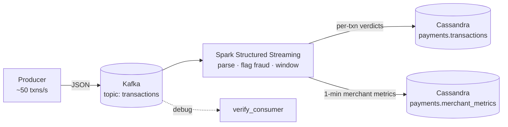

# Real-Time Streaming Pipeline — Kafka → Spark Structured Streaming → Cassandra

A real-time **fraud-detection** pipeline for payment transactions. Events are
produced to **Apache Kafka**, processed in flight by **Spark Structured Streaming**
(row-level fraud rules + event-time windowed aggregations with watermarks), and
the results are written to **Apache Cassandra** (NoSQL). The whole stack runs with
one `docker compose` command.



## What it demonstrates

| Area | In this project |
|---|---|
| **Streaming / real-time** | Spark **Structured Streaming**, `readStream`/`writeStream`, `foreachBatch` sinks |
| **Message broker** | **Kafka** producer + topic, at-least-once delivery, keyed partitioning by account |
| **Event-time processing** | Tumbling `window()` aggregations with **watermarks** to bound state |
| **NoSQL** | **Cassandra** data modeling — partition keys chosen for the query pattern |
| **Distributed compute** | Spark on a cluster; connectors for Kafka & Cassandra |
| **Testability** | Streaming transforms factored into pure functions, unit-tested on static data |

## Run it

Prerequisites: Docker + Docker Compose.

```bash
# 1) bring up kafka + cassandra + the streaming job (creates schema automatically)
make up            # ≈ docker compose up ...

# 2) in a second terminal, start streaming transactions into Kafka
pip install kafka-python
make produce       # ~50 events/s, ~3% crafted to trip fraud rules

# 3) watch the console sink in the `make up` terminal, or query Cassandra:
docker compose exec cassandra cqlsh -e \
  "SELECT merchant, amount, country, fraud_reason FROM payments.transactions WHERE is_fraud = true ALLOW FILTERING;"
```

Peek at the raw stream without Spark: `make consume`.

## Unit tests (no Kafka needed)

Because Structured Streaming reuses the batch DataFrame API, the transforms are
tested against small static DataFrames with a local Spark:

```bash
make test        # parse_kafka_json · flag_fraud · windowed_merchant_metrics
```

## How the streaming logic works

1. **Ingest** — `readStream` from Kafka; each message value is JSON parsed against a
   fixed schema (`streaming/transforms.py::parse_kafka_json`).
2. **Detect** — `flag_fraud` applies explainable rules (high amount, high-risk
   country, non-positive amount) → `is_fraud` + `fraud_reason`. (Swap in an ML
   model here in production.)
3. **Aggregate** — `windowed_merchant_metrics` computes per-merchant counts, total
   amount, and fraud counts over 1-minute event-time windows, with a 2-minute
   **watermark** so state for late data is eventually dropped.
4. **Sink** — two `foreachBatch` writers persist per-transaction verdicts and
   rolling metrics to separate Cassandra tables, each with its own checkpoint for
   exactly-once-into-the-sink semantics.

## Project structure

```
producer/producer.py            # Kafka producer (synthetic transactions)
streaming/transforms.py         # pure, unit-tested streaming logic
streaming/streaming_job.py      # the Spark Structured Streaming job (Kafka->Cassandra)
consumer/verify_consumer.py     # tiny debug consumer
cassandra/init.cql              # NoSQL keyspace + tables
docker-compose.yml              # kafka + zookeeper + cassandra + spark
tests/test_streaming_transforms.py
```

## Scaling notes

* Kafka topic partitions → Spark stream parallelism; key by `account_id` keeps a
  customer's events ordered within a partition.
* Cassandra partition key (`merchant`) spreads writes and matches the read path;
  clustering by `event_time DESC` makes "latest N" queries cheap.
* On a real cluster, submit `streaming_job.py` to YARN/K8s and point `--bootstrap`
  at the broker set — no code changes.
