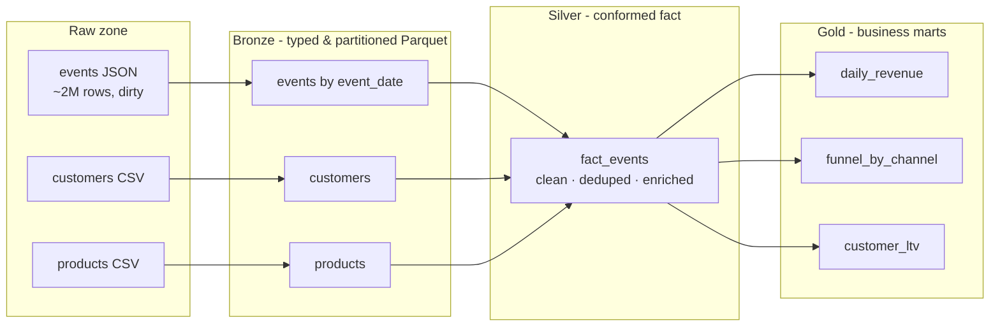

# Spark Data Lakehouse — Batch Big-Data Pipeline (Medallion Architecture)

A production-shaped **PySpark** lakehouse that ingests multi-source raw feeds and
refines them through **bronze → silver → gold** layers into business-ready data
marts. Built to demonstrate real distributed-data-processing patterns: partitioned
columnar storage, broadcast joins, Adaptive Query Execution, data-quality gating,
and a testable, modular codebase.

> Runs locally on a single machine via Spark's `local[*]` mode, and unchanged on a
> real cluster (YARN / Kubernetes / EMR / Dataproc) simply by changing the master.

---

## What it demonstrates

| Area | In this project |
|---|---|
| **Distributed processing** | Apache Spark 3.5 (DataFrame API), partition-parallel reads/writes |
| **Big-data storage** | Partitioned, Snappy-compressed **Parquet** data lake (HDFS/S3/GCS-ready) |
| **Performance engineering** | **Adaptive Query Execution**, **broadcast-hash joins**, partition pruning, skew-join handling, `cache()` reuse |
| **Data modeling** | Medallion (bronze/silver/gold), star-schema enrichment, dimensional joins |
| **Data quality** | Null/negative/enum rules, deterministic **deduplication** (window `row_number`), an expectations report |
| **Engineering hygiene** | Pure, unit-tested transforms; CLI-driven stages; config; `Makefile` |

## Architecture



The **events** feed is intentionally dirty — ~2% null customers, ~1% negative
quantities, ~1% exact duplicates — so the silver layer has real cleansing and
deduplication work to do. The dimensions are small, so they are **broadcast** into
the join to avoid shuffling the huge fact table.

## Quickstart

```bash
pip install -r requirements.txt

# 1) generate ~2M synthetic events + dimensions into data/raw
make gen

# 2) run the medallion pipeline: bronze -> silver -> gold
make run

# 3) unit tests (local Spark, no cluster needed)
make test
```

Run a single layer: `python -m lakehouse.pipeline --base data --stages silver,gold`.

## Sample output

The silver stage prints a data-quality report, e.g.:

```
data-quality: {'raw_rows': 303041, 'clean_rows': 291204, 'dropped_rows': 11837, 'dropped_pct': 3.91}
```

Gold marts (examples):

```
gold/daily_revenue      revenue / units / buyers / orders  by date · category · country
gold/funnel_by_channel  view → add_to_cart → purchase conversion rates by channel/day
gold/customer_ltv       lifetime value · order_count · recency  per customer
```

## Project structure

```
src/lakehouse/
  spark_session.py   # tuned SparkSession (AQE, shuffle, Kryo, broadcast threshold)
  generate_data.py   # synthetic multi-source raw feeds (with injected dirtiness)
  transforms.py      # pure DataFrame->DataFrame logic (unit-tested)
  data_quality.py    # expectations / assertions
  pipeline.py        # bronze -> silver -> gold orchestration (CLI)
tests/test_transforms.py
```

## Running on a real cluster

Nothing about the code is local-only. To run on Dataproc / EMR / a Spark-on-K8s
cluster, submit `pipeline.py` and point paths at object storage:

```bash
spark-submit --master yarn --deploy-mode cluster \
  src/lakehouse/pipeline.py --base gs://my-bucket/lakehouse
```

Partitioning by `event_date` gives partition pruning on downstream reads; the same
Parquet layout is query-ready from BigQuery external tables, Athena, or Trino.
