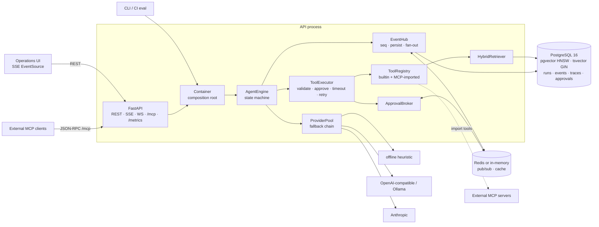
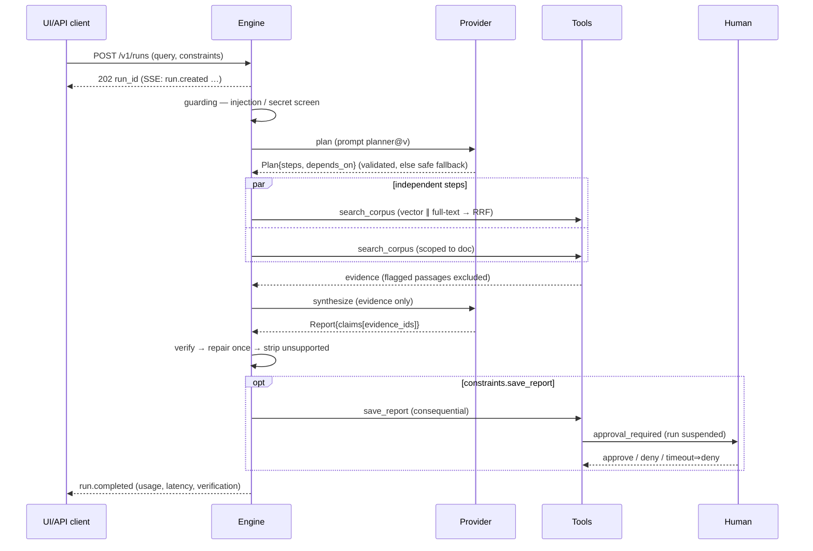
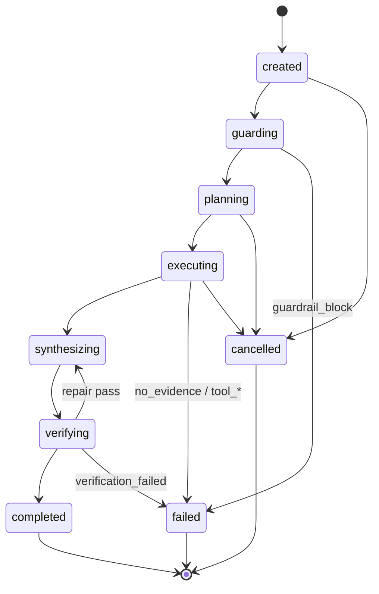
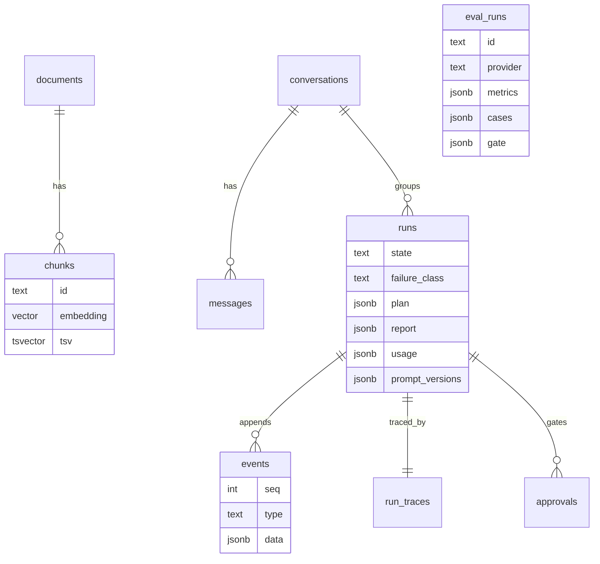

# Architecture

## Components

## One run

## State machine

Approval waits happen *inside* `executing`/after `verifying` as events (`tool.approval_required` / `tool.approved|denied`); `interrupted` is assigned at startup to runs that were in flight when the process died.

## Data model

## Event contract (what the UI renders)
`run.created · state.changed · guardrail.input|evidence · plan.created|fallback · step.started|completed · tool.requested|approval_required|approved|denied|completed|failed|retrying · evidence.added|pruned · usage.updated · provider.retrying|error|fallback · verification.completed · report.title|claim|limitation|final|saved|not_saved · run.completed|failed|cancelled`
Events carry a gap-free per-run `seq`; clients resume with `Last-Event-ID` / `?after=`. They contain plans, tool I/O, evidence and verdicts, never model reasoning.

## Package map
`api/` HTTP surface · `orchestrator/` engine, executor, approvals, events, verifier · `providers/` LLM adapters, pricing, registry · `retrieval/` chunking, embeddings, hybrid search, ingestion · `tools/` registry, built-ins, MCP · `storage/` schema + repo · `eval/` dataset, metrics, runner, baselines · `prompts/` versioned templates · `ui/` operations console.
